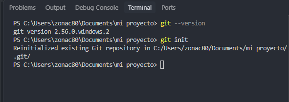
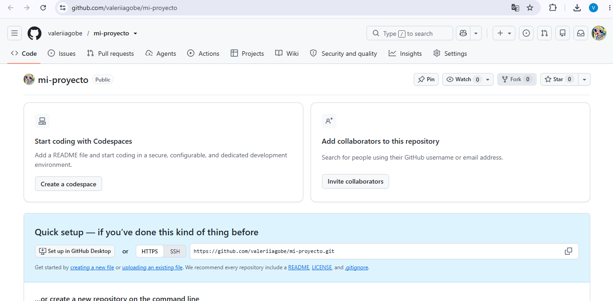

<!-- Ejemplos básicos de Markdown -->

# Guía Paso a Paso: Conexión de Proyecto Local con GitHub en Visual Studio Code

## Creación de la carpeta del proyecto
Primero, creamos la carpeta principal del proyecto (mi proyecto) directamente en el sistema de archivos del equipo.

## Apertura en Visual Studio Code y creación de la estructura
Abrimos esa carpeta en Visual Studio Code. Estando dentro del editor, creamos y organizamos toda la estructura interna de trabajo en el panel del Explorador, añadiendo las carpetas necesarias (docs, src, test), el archivo principal index.html y el archivo README.MD.

## Verificación e Inicialización de Git en la Terminal

**Verificación de Git:** Abrimos la terminal integrada en Visual Studio Code y ejecutamos el comando git --version para verificar la versión de Git instalada en el sistema (2.56.0.windows.2).

**Inicialización del Repositorio:** A continuación, ejecutamos el comando git init para inicializar el repositorio local dentro de la carpeta del proyecto y habilitar el control de versiones.

## Sincronización y subida a GitHub

En la sección de Control de código fuente (Source Control), Visual Studio Code detecta automáticamente todos los archivos y carpetas creados (identificados con la etiqueta U).

Finalmente, registramos los cambios (Commit) y utilizamos la opción de publicar la rama (Publish Branch) para que todo lo que diseñamos y estructuramos localmente en Visual Studio Code se suba y quede conectado con GitHub.

[Enlace a GitHub](https://github.com/valeriiagobe/mi-proyecto.git)
